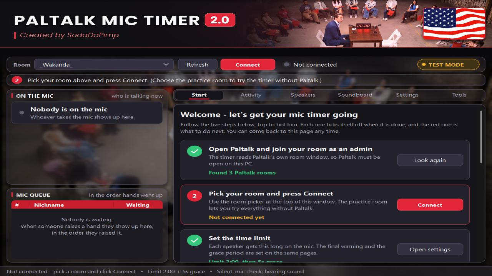
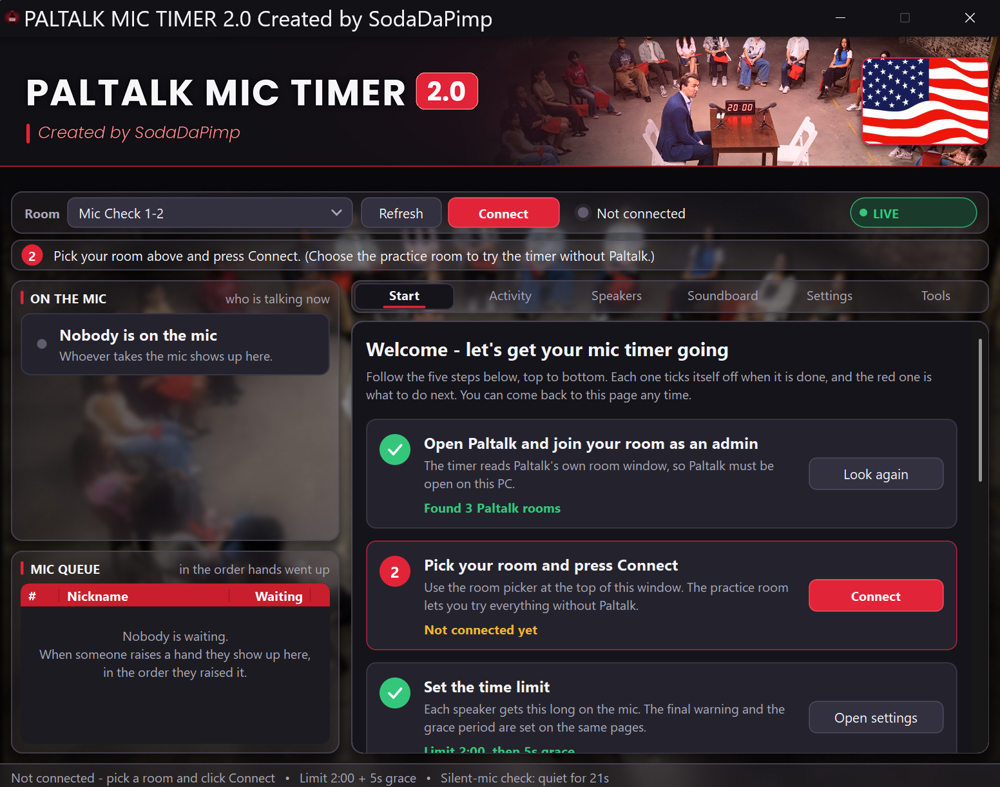
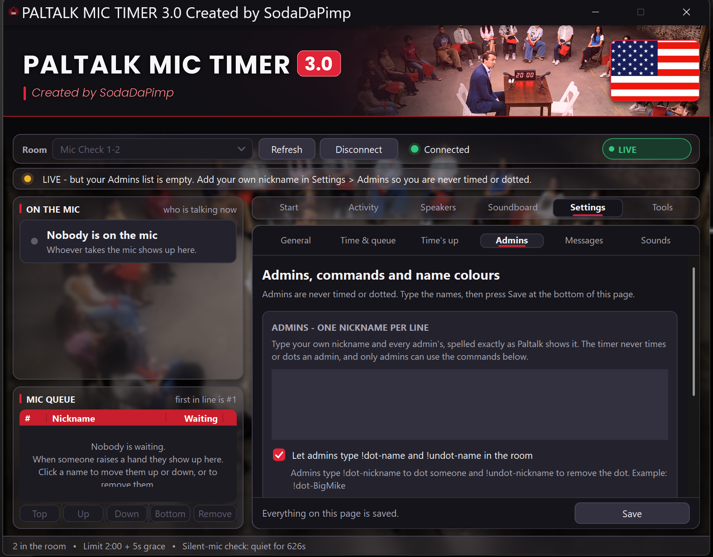

# PALTALK MIC TIMER 3.0

**A Windows mic timer, mic queue and auto-dot tool for Paltalk room admins. Written in C++.**

## Table of contents

- [What it does](#what-it-does)
- [Changelog](#changelog)
- [What you need](#what-you-need)
- [Quick start](#quick-start)
- [What happens during a turn](#what-happens-during-a-turn)
- [The main window](#the-main-window)
- [Settings, one by one](#settings-one-by-one)
- [Admin commands](#admin-commands)
- [Sounds](#sounds)
- [Tools tab](#tools-tab)
- [Troubleshooting](#troubleshooting)
- [Credits and disclaimer](#credits-and-disclaimer)

## What it does

PALTALK MIC TIMER 3.0 keeps a Paltalk voice room fair. It watches who is on the mic, times each turn, warns people as time runs out, and **dots** (restricts) anyone who goes over the limit. It tells the room why, then takes the dot off a few seconds later. It also shows the mic queue, plays sound effects (a bell when time is up, and more), and lets your admins dot and undot from the chat by typing `!dot-nickname` and `!undot-nickname`.

**Dotting** is Paltalk's **Restrict** option on a member's right-click menu; **Remove Restrictions** undoes it. The timer uses both for you.

- Times whoever is on the mic and shows the mic queue.
- Posts a time check, a final warning and a time's-up message in the room.
- Dots people who go over the limit, explains why in the room, then removes the dot.
- Keeps the mic queue in order and dots anyone who takes the mic out of turn, so the next person in line can talk.
- A **Free mic** switch turns the timer off for everyone: no time limit, no warnings, no dots. With it off, the mic queue is **strict**: only people in the queue may take the mic. Anyone who takes it without raising a hand first, or ahead of people who are still waiting, is dotted at once and told why in the room.
- Lets admins dot and undot from the chat with `!dot-nickname` and `!undot-nickname`.
- Posts a mic check if the person on the mic goes silent.
- Shows an animated poster card in the banner. Use the built-in waving-flag poster, **your own picture (a GIF, PNG or JPG)**, or switch it off.
- Plays sounds on your speakers and, if you set it up, into the room. It can even click Paltalk's mic button for you to do that.
- One small program. Nothing to install.

## Changelog

This is everything that changed from the original Python program (version 1.x) to **3.0**: what was added, what was changed and what was fixed. 3.0 is a complete rewrite in C++, so it is one small program with nothing else to install. Your old `config.json` is converted automatically and keeps working the way it did.

Jump to: [New in this release](#new-in-this-release) | [Added](#added-in-30) | [Changed](#changed-in-30) | [Fixed](#fixed-in-30) | [Upgrading from 1.x](#upgrading-from-1x)

### New in this release

Two big changes: **nobody can talk over a speaker any more**, and **you can now run the mic queue from the timer.** The strict queue rule has also been checked again from start to finish, and the help text, the tour and this README were brought up to date.

- **Nobody can interrupt a speaker.** Before, a person who joined the queue could grab a second mic while somebody was talking and was not dotted. Now anyone who takes the mic while another person is on it is dotted, **even the person who is first in line**. The dot comes off by itself after the usual delay, and the room is told who was talking, for example *Bob was dotted for taking the mic while Sam was talking. Raise your hand and wait your turn.* The message is on the Messages page (*Took the mic while somebody was talking*) and has a new `{speaker}` placeholder.
- **A hand-over is never mistaken for an interruption.** Somebody who takes the mic over a speaker is looked at again half a second later. If the speaker has gone by then, the new speaker is left alone; if the speaker is still there, the dot follows. A speaker who has already been dotted (for going over time, or by an admin) can't be interrupted, but one who is over time and still talking in the grace period can.
- **Move people up and down in the Mic Queue.** Click a name in the MIC QUEUE list, then press **Top**, **Up**, **Down**, **Bottom** or **Remove** under the list. The timer does it for you through Paltalk's own right-click > Mic Queue menu, so you no longer have to open Paltalk to do it.
- **The timer's queue follows every move.** The person you send to the top is first in line, and the people they passed each move down one place. Moving somebody from the bottom to #1 is the one way to put them first without waiting, and it is never counted as jumping the queue. Everybody else must wait their turn.
- **Remove takes somebody out of the queue.** A person who was removed and still has their hand up for a moment is not put back in line, and if they then take the mic they are dotted: they are not in the queue.
- **The strict queue rule is checked in every case.** Somebody who takes the mic without being in the queue is dotted, somebody who takes it ahead of people still waiting is dotted, and somebody who takes it while another person is talking is dotted. The person at #1 or a person who was moved to #1 may take a free mic, an admin is never dotted, and somebody who was already on the mic when you pressed Connect is never dotted for it.
- **Careful with Paltalk's menu.** Before the timer clicks anything in Paltalk's Mic Queue menu it reads the menu from a picture of the screen and checks that it really is that menu. If it is not, it closes the menus, clicks nothing and tells you in a red *FAILED* line in the Activity tab. It never guesses between two people with the same name: it asks you to type the full nickname.
- **The queue buttons only switch on when they make sense.** With no name selected they are all off, the person at #1 cannot be moved Up or to the Top, and the last person cannot be moved Down or to the Bottom. When a move cannot be done, the Activity tab says why.
- **Updated help and tour** in the program, and the new *Moving people in the mic queue* section in this README.
- **398 automated tests** (up from 374), including a check of 300 random rooms against an independent copy of the queue rules.

**Good to know:** the timer cannot see a move you make by hand in Paltalk, because Paltalk does not let other programs read the nicknames in its queue. After a move by hand, use the buttons or ask people to lower and raise their hands. Details are in *Moving people in the mic queue* below.

### Added in 3.0

**The program**

- **Rewritten in C++.** A native Windows program in one small `.exe`. No Python and nothing to install.
- **A practice room.** Choose *Practice room (no Paltalk needed)* in the Room box and press **Take mic** for a pretend person, to watch a whole turn in seconds (set the limit to 30 seconds to make it quicker).
- **Automated tests.** 398 tests run the timer against a pretend Windows and a pretend Paltalk, so the rules (turns, dots, the queue, sounds, settings, pictures) can be checked without a real room.

**The window**

- **A redesigned window:** a photo background with frosted-glass panels, a control strip with a live **TEST MODE / LIVE** badge, a guide line that always says what to do next, big round speaker cards, rounded buttons and tabs, and the same careful spacing everywhere. It shrinks itself to fit small screens and high Windows scaling.
- **A Start tab for new users:** five steps that tick themselves off, each with a button that does it for you, plus a short *How it works* and *Where do I find things?* guide.
- **A Soundboard tab:** a button for every built-in sound and every `.wav` file in your `sounds` folder.
- **A Jumped column on the Speakers tab:** how often each person took the mic ahead of people who were waiting, next to turns taken, talk time, longest turn, warnings and dots.
- **A tidier Tools tab:** five numbered cards that check the timer works with your copy of Paltalk.
- **Settings on six pages:** General, Time & queue, Time's up, Admins, Messages and Sounds, each in cards with a plain explanation. Changes save as you make them; only the text boxes use the **Save** button at the bottom.

**The banner poster**

- **An animated poster card in the banner:** a waving American flag that plays at the GIF's own speed. Click it to skip ahead, or switch it off in **Settings > General**.
- **Your own picture:** use a GIF (animated or not), PNG or JPG. Press **Choose your own picture...** or drag a picture file onto the window. The card resizes to fit it, and **Use the built-in poster** puts the original back. Phone photos that are stored sideways are turned the right way up, see-through PNGs work, and files up to 25 MB are accepted. A file that cannot be used is refused with a plain-English reason and you keep the picture you had.

**The mic queue and who may take the mic**

- **Queue jumpers are dotted.** The timer keeps the mic queue in order. Anyone who takes the mic ahead of people still waiting is dotted, and the room is told who is next. Admins are exempt.
- **A strict queue rule.** Only people in the queue may take the mic, one at a time. Anyone who takes it without being in the queue, or while somebody else is talking, is dotted, even a free mic with nobody waiting, and the room is told why. A person who was already on the mic when you connected is never dotted for it. There is nothing to choose: only this one rule is offered.
- **The front of the line has 2 minutes** (you can change it; 0 means never) to take a free mic before they lose their turn.
- **Move people in the Mic Queue from the timer.** Click a name in the MIC QUEUE list, then **Top**, **Up**, **Down**, **Bottom** or **Remove**. The timer uses Paltalk's own right-click > Mic Queue menu for you, and keeps its own queue in step, so the person you move to the front is not dotted. A menu it does not recognise is never clicked. Moves you make by hand in Paltalk can't be seen by the timer, so use the buttons.

**Sounds and the room's microphone**

- **Eleven built-in sounds:** Bell, Double ding, Chime, Heads-up beeps, Fanfare, Air horn, Buzzer, Pop, Tick-tock (10 and 5 seconds) and Horse race caller.
- **Tick-tock and Horse race caller** for the final warning. The tick-tock is a ticking clock that speeds up. The race caller is hoofbeats, a bugle and a crowd with a spoken race call made with Windows' own voice (or your own recording).
- **Your own sounds:** put `.wav` files in the `sounds` folder. A file that is broken falls back to the built-in sound.
- **A sound for every moment:** each timer event can play its own sound on your speakers, into the room, or both, with a master switch and a volume control.
- **Sounds go out on your real mic.** With **Take the mic** ticked, every warning, bell and soundboard button takes the mic when it happens, plays into the room and lets go. Choose click, hold or automatic.
- **Mic helper tools** on the Tools tab: **Test the mic**, **Find the mic button**, **Teach it the mic button** and **Forget the taught spot**, for when the timer cannot find Paltalk's mic button by itself.
- **A command that cannot be done is reported.** If `!dot` or `!undot` fails, the room hears a line like *Boss, Ghost could not be dotted.* (the admin who typed it, then the person).

**Built to keep running**

- **A crash log.** A problem inside the program is written to `logs\crash.log` and the timer carries on.
- **One copy at a time,** and closing the window never leaves an invisible copy running.
- **Limits that stop a mess:** the timer never holds your mic for more than 90 seconds at a time, and a dot that is waiting for the speaker to finish comes off after 30 minutes at the latest.

### Changed in 3.0

- **One name everywhere:** the program, the window, the file properties and the exe are all called **PALTALK MIC TIMER 3.0 Created by SodaDaPimp**. The old exe was called *Paltalk Mic Timer Created by SodaDaPimp.exe*.
- **Commands only is now Free mic.** It is the same idea (the timer is off for everyone: no time limit, no warnings, no dots), now one switch at the top of **Settings > Time & queue**. Your old setting is carried over.
- **The queue ticks became one strict rule.** The separate queue ticks and the choice of rules (*No jumping the line*, *Only people in the queue*, *Strict*) are gone; the strict rule above is the only one left, because a room with one mic does not need the other two. An old config that had them is converted and the old setting is dropped.
- **Nothing is listed twice any more.** The *explain why*, *say so*, *grace period* and *read nickname colours* ticks are gone. Leave a message empty to say nothing, set the grace to 0 for no grace, and leave the colour list empty to skip colours. Old files are converted so everything behaves the way it did.
- **The room is read more often:** every 0.25 seconds by default, instead of every second, and the right-click menu waits less before it is read.
- **Shorter messages.** Every message the timer posts is now one short line, the extra thank-you sentence is gone, and the two queue messages lost the placeholders that no longer exist. A message you wrote yourself is kept (minus that sentence); a message that still had the old wording gets the new one.
- **Messages are plain text.** The built-in messages have no emoji, and emoji in an older config are removed (your own edits are kept).
- **The reply to someone who is not an admin** now reads *Name, only room admins can use the dot commands.* It no longer contains the command words.

### Fixed in 3.0

**Chat commands and replies**

- **The timer answered itself in a loop.** Its own *only room admins can use !dot and !undot* reply was read as if somebody had typed a command, so the timer kept replying to its own reply and flooded the room. Now the timer never reacts to its own posts, a command only counts when it is the whole message, the reply no longer contains the command words, and it is limited to one reply per person per minute and one every 10 seconds overall. Old config files that still had the looping wording are cleaned automatically.
- **Commands failed on some nicknames.** Paltalk can put an invisible symbol on the end of a nickname in chat (it showed up as a small box in the logs), so `!dot-Name` did not match the person. Names are now compared with hidden characters and extra spaces removed and capital letters ignored.
- **Commands could be missed or run twice when the chat was busy.** The timer now follows only the new chat lines and keeps its place even when Paltalk trims old lines.
- **Emoji in room messages** came out wrong because Paltalk cannot show them from a bot. They are no longer sent, and when text has to be simplified the emoji are dropped cleanly.

**Dotting and undotting (the right-click menu)**

- **Dots that failed with *the right-click menu didn't show up*, *none of its entries could be read*, *the member search box didn't open* or *no Restrict option in the menu*.** The timer now finds the person by name, falls back to Paltalk's member search when the name has scrolled out of view, and reads the menu entries even when there is no *Bounce* entry. If it cannot be sure, it clicks nothing and saves what Paltalk showed (text and pictures) in the `logs` folder so the problem can be fixed.
- **Failed dots are retried, then reported.** A dot is tried up to 3 times, and a queue jumper is retried every half second up to 8 times because Paltalk's own list can lag a moment. If it still fails, you get an alert to dot the person by hand.
- **The error `CoInitialize has not been called`** when dotting from a chat command (seen in the Python version). Windows' UI Automation is now started properly on the thread that drives Paltalk.
- **The right person, every time.** Two people with the same name are never guessed between, a name that has scrolled out of sight is never clicked, a blank or highlighted first menu row is read correctly and never clicked, and a sub-menu row is never taken for *Restrict*. *Remove Restrictions* means the person is dotted.
- **No double toggling.** Dotting someone who is already dotted, or undotting someone who is not, clicks nothing.
- **Dots that were never taken off.** The timer used to give up on an undot after 4 tries (about 9 seconds), so one slow answer from Paltalk could leave somebody dotted for good. It now keeps trying: 4 quick tries, then every 20 seconds, then once a minute, for up to 30 minutes, with a red alert after the 4th failed try and another if it finally gives up. Somebody who left the room is looked for once a minute, and the dot comes off if they come back. Everyone is told *your dot has been removed* only when it really came off.
- **Dots left on when the timer was closed.** Closing the timer takes every dot off first and now tries each one 3 times. If one still cannot be removed (or the program is killed), the person is written to `still_dotted.json` next to the `.exe`, and the dot comes off, quietly, the next time that room is connected. Notes older than 12 hours are ignored, and pretend dots made in TEST MODE are never remembered.
- **False *dot didn't work* warnings.** The timer only warns when a person is still on the mic list several seconds after being dotted. If the dot worked and they left the list, you hear nothing, and a dot that is taken off again at once is not judged at all.

**The mic queue and who may take the mic**

- **The announcement no longer waits 3 seconds.** *Sam has the mic. Time limit: 2 minutes.* is now posted the moment the timer sees Sam on the mic. It used to wait until he had held the mic for 3 seconds, which looked like lag. If you want the wait back to stop quick taps filling the chat, set *Announce a new speaker after* on Settings > Time & queue to 3. A setting you had changed yourself is kept; one left at 3 becomes 0.
- **The lag when somebody grabs the mic.** The timer re-read the room's whole chat history four times a second, looking for !commands. In a busy room that took long enough to hold up everything else, Paltalk included, so people were noticed a few seconds late. It now asks Paltalk how long the chat is (that is cheap) and reads the text only when somebody has said something, and at least every 3 seconds. A dot also reuses the look at the room the timer took a moment before, instead of reading the room a second time, and a right-click menu with nothing readable in it is not waited on again.
- **You can see where the time goes.** Each dot's line in the Activity tab ends with how long it took and where, for example *[1.4s: window 0.1, find 0.6, menu 0.3, read 0.1, click 0.3]*. If a look at the room takes longer than 0.8 seconds, the Activity tab says *Paltalk is slow to answer*, once a minute at most.
- **Dots are faster.** A person who takes the mic out of turn is dotted in the first look at the room that shows them, ahead of any undot that is due, and the dot no longer waits for a sound that is playing or for the mic button you are holding. The Activity tab shows how long each one took (*Sam was dotted 0.9s after taking the mic.*).
- **The dot is no longer held back for the person who was interrupted.** The old *Only people in the queue* rule kept a dot on until the speaker had finished; it now comes off after the usual delay.
- **A stuck hand no longer gets every speaker dotted.** A person who has walked away, or whose hand never comes down, is passed over and stops holding everybody else up.
- **The next person in line is not dotted** when Paltalk shows them on the mic a moment after their hand goes down, and a person who gave up their place is no longer counted as waiting.
- **The timer's own mic clicks are never a jump,** and it remembers its own name, so somebody else grabbing the mic at the same moment is not mistaken for you.
- **Fair judgement of people who arrive together.** Two people who raise their hands at the same moment are not judged against each other, and an outsider who arrives with a person from the queue is the one who is dotted.
- **One dot, not two,** when a rule includes the one before it.
- **A jumper who grabs the mic again** after the dot comes off is dotted again.

**Turns, timers and announcements**

- **Quick taps on the mic are no longer announced,** and a quick re-grab does not repeat the *has taken the mic* message.
- **A speaker who drops off the mic list while a sound plays keeps their timer,** and the room is not told twice that they took the mic. A short blip off the mic never ends a turn.
- **Switching Free mic off gives everyone on the mic a fresh turn.**

**Sounds and the mic button**

- **A pile of long sounds could keep your mic for minutes.** The timer now never holds it for more than 90 seconds at a time.
- **A sound that is not switched on for the room never takes the mic,** and nothing plays or clicks in TEST MODE or when sounds are off.
- **A push-to-talk button is always let go.** It is never held forever, it is released if the room goes away or the mic never opens, a dot lets go of it first instead of waiting, and a locked mic that ignores the second click is let go with Ctrl.
- **Only the real mic button is ever clicked.** *Join queue to talk*, the little arrow next to the lock button and other buttons are never clicked.
- **A broken sound card, a broken `.wav` file or a voice that cannot be made never stops the timer.** The sound is skipped (a broken file falls back to the built-in one) and everything else carries on.

**The window**

- **Scroll bars did not match the dark window.** Every scroll bar and list header is now dark, whatever Windows' light or dark setting is.
- **The window could be too big for a small screen or lose its layout** when dragged to a screen with different Windows scaling. It now scales itself down to fit and keeps its layout at every scale.
- **Empty tables** (Speakers and the queue) stay clean and say what they are waiting for, and the red bar clears itself after about 25 seconds.
- **Every setting appears exactly once,** every control points at its own field, and the texts have no double spaces or leftover section numbers.
- **A confusing label on the Messages page.** The *Time is up - grace period* message used to talk about a tick that no longer exists. It now says when it is posted: at the limit, when the grace period is more than 0 seconds.

**Staying up**

- **A problem inside the program no longer takes it down.** It is written to `logs\crash.log` and the timer carries on. A second copy will not open, and closing the window never leaves an invisible copy running, even when the background work is stuck waiting for Paltalk.
- **Damaged or unusual pictures** (GIF, PNG or JPG) can never crash the timer or make it hang. They are refused with a plain reason.
- **Bad values in `config.json` are clamped** to sensible ones instead of breaking the timer.
- **Paltalk oddities are handled.** An empty or unreadable room is reported instead of failing silently, a room that was closed is reported instead of crashing, names that cannot be read are counted, and a bogus *hand up* flag in Paltalk's member list is ignored.

### Upgrading from 1.x

- Put the new `.exe` in its own folder, as before. If you copy your old `config.json` next to it, it is converted the first time the new program reads it. Your admins, colours and settings carry over, and so do your own message edits.
- The timer still saves its settings in `config.json`, its logs in a `logs` folder and your own sounds in a `sounds` folder, all next to the `.exe`.

How old settings files are converted (technical)

Each settings file carries a version number. When an older file is read, these steps are applied in order:

| Version | What the conversion does |
|---|---|
| 2 | Settings from the very first version take the new messages and timings. |
| 3 | Emoji are removed from messages (Paltalk cannot show emoji sent by a bot). The old send-encoding and sound-threshold settings are dropped. |
| 4 | An old *not an admin* reply that contained the command words is removed, because it set off the timer itself. |
| 5 | A room check interval of exactly 1 second goes back to the new faster default (0.25 seconds). |
| 6 | Options that said the same thing twice are merged: an *off* tick becomes a grace of 0, an empty message or an empty colour list. |
| 7 | *Commands only* becomes *Free mic*, and the separate queue ticks are merged into one queue rule. |
| 8 | Only the strict queue rule is left, so the rule choice is dropped. A room check of exactly 0.4 seconds and a menu wait of exactly 0.6 seconds go to the new, faster defaults (0.25 and 0.3). Messages still in the old default wording take the new, shorter wording; your own messages are kept, minus the extra thank-you sentence. The queue-only message becomes the *took the mic without being in the queue* message. |
| 9 | *Announce a new speaker after* goes from 3 seconds to 0 (a different number you chose is kept). |

A config file written by the Python version is read as it is.

## What you need

- A Windows 10 or 11 PC.
- The Paltalk desktop app, signed in and with your room open.
- **Admin or owner rights in the room.** The timer dots people the same way you do (it right-clicks their name in Paltalk), so it needs your permissions.

## Quick start

The timer starts in **TEST MODE**. Nothing is dotted, posted or clicked while it is on; the Activity tab only shows what the timer would do. That makes it safe to look around first.

The program opens on the **Start** tab. It lists five steps, top to bottom. Each step ticks itself off when it is done, the red one is what to do next, and every step has a button that does it for you or takes you to the right page. The line under the banner always says what to do next, too.

1. Open Paltalk and join your room as an admin.
2. Download **PALTALK MIC TIMER 3.0 Created by SodaDaPimp.exe** from the [Releases page](https://github.com/SodaDaPimp/PALTALK-MIC-TIMER/releases), put it in its own folder and double-click it. If Windows says *Windows protected your PC*, click **More info**, then **Run anyway**. Windows shows this for every new program.
3. In the timer, pick your room in the **Room** box at the top (click **Refresh** if it is missing), then click **Connect**. The timer posts one line in the room to say it is connected. The dot beside the room box turns green when it can read the room.
4. Optional: change the time limit on **Settings > Time & queue** (the default is 2 minutes).
5. Open **Settings > Admins**. Type your own nickname and your admins' nicknames, one per line, spelled exactly as Paltalk shows them. Press **Save** at the bottom of the window.
6. Let someone take the mic and watch the **Activity** tab. With TEST MODE on it says things like *Would post: ...* and *Would dot ...*.
7. When you are happy, press **Go live** on the Start tab, or untick **TEST MODE** on **Settings > General**. The timer is now live.
8. To stop, click **Disconnect** or close the window. It removes any dot it is still holding and posts that it has disconnected.

**Want to practise without a real room?** Choose *Practice room (no Paltalk needed)* in the Room box and click Connect. A Practice window opens: pick a pretend person and press *Take mic*. Set the time limit to 30 seconds to watch the whole cycle quickly.

The timer saves your settings in **config.json**, its logs in a **logs** folder and your own sounds in a **sounds** folder. All three are created next to the .exe, which is why it should live in its own folder. A fourth file, **still_dotted.json**, only appears while the timer has a dot it could not take off yet, and the timer deletes it once the dot is off.

## What happens during a turn

This is the default behaviour with a 2-minute limit. Every time and message below can be changed in Settings.

| When | What happens |
|---|---|
| 0:00 | Someone takes the mic. Their timer starts, and the room reads: *Sam has the mic. Time limit: 2 minutes.* (You hear a soft pop.) If you set *Announce a new speaker after* to a number of seconds, the room hears it after that wait, which stops quick taps from filling the chat. |
| 0:30, 1:00, 1:30 | A time check: *1 minute 30 seconds left for Sam.* |
| 1:50 | The final warning: *10 seconds left - please wrap up.* (Three quick beeps.) |
| 2:00 | Time is up. The bell rings. The room reads: *Sam, time is up. Release the mic or you will be dotted in 5 seconds.* |
| 2:05 | Still talking? The timer dots Sam, plays a double ding, and tells the room why: *Sam was dotted for going over the 2-minute limit. Raise your hand to get back in line.* |
| 2:10 | The dot comes off by itself and the room reads: *Sam, your dot has been removed.* (A chime.) Sam can raise a hand to get back in the queue. |

- **Grace period set to 0?** The bell and the dot both happen at 2:00, with no warning message in between.
- **Admins and untimed colours** are never timed or dotted. Their card turns grey and says *timer paused*.
- **Anyone who takes the mic out of turn** is dotted: somebody who was not in the queue, who skipped ahead of people still waiting, or who took the mic while another person was talking (see *The mic queue* below).
- **A short blip** off the mic does not end a turn. If someone drops off and is back within a few seconds, their timer simply continues.
- **A dot given with !dot-name** stays on until an admin types `!undot-name`.
- **Silent mic?** If exactly one person is on the mic and nothing has been heard for 15 seconds, the timer posts *Sam, no audio detected - please check your mic.* and plays a buzzer.
- When it connects and when it disconnects, the timer posts a one-line credit message. That is built in and cannot be switched off.

## The main window

The window has the same layout all the time: a banner at the top, a control strip with a guide line under it, the speakers on the left and six tabs on the right. The **photo behind everything** is only decoration.

### Top and left

| Part | What it shows |
|---|---|
| Banner and poster | The title, and in the top right a little animated poster card. The built-in poster is a waving American flag that plays at its own speed; an animated GIF of your own does too. Click it to jump to the next picture. You can switch it off or use your own picture (see *Using your own picture* below). |
| Room box, Refresh, Connect | Pick your Paltalk room and connect. The button becomes Disconnect while connected. |
| Status dot and words | Green = connected and reading the room. Amber or red = connected but it cannot read the room (see Troubleshooting). Grey = not connected. |
| TEST MODE / LIVE badge | The round badge at the right of the control strip. Amber **TEST MODE** = practice, nothing is really dotted or posted. Green **LIVE** = the timer is really acting. Click it to go to the switch on Settings > General. |
| Guide line | The one line under the control strip that tells you the single next thing to do, for example *Pick your room above and press Connect*. It turns amber or green when something needs attention or all is well. |
| Red bar | A problem that needs your attention. Click it to dismiss it, or leave it - it clears by itself after about 25 seconds. Everything is also kept in the activity log. |
| ON THE MIC | One card per person on the mic: their name, how long they have talked, and a progress bar. Green = within the limit. Amber = almost out of time. Red = over the limit or dotted. Grey = timer paused (an admin or an untimed colour). When nobody is on the mic it says so. |
| Pink line | Appears under the cards while a dot is on and counts down to when it comes off. |
| MIC QUEUE | Everyone with a hand up, in order, with how long they have waited. Click a name, then use the buttons under the list: **Top**, **Up**, **Down**, **Bottom** or **Remove** (see *Moving people in the mic queue* below). |
| Bottom line | A summary of the current setup: how many people are in the room, the limit, grace period and the dead air check. |

### The six tabs

| Tab | What it is for |
|---|---|
| Start | The five-step checklist for new users, plus a short *How it works* and a *Where do I find things?* guide. Come back to it any time. |
| Activity | A colour-coded log of everything the timer sees and does. Blue = mic events, purple = queue, amber = warnings, pink = actions such as dots and mic clicks, green = messages it posted, red = problems. The same log is saved in the logs folder, one file per day. |
| Speakers | Statistics since the timer started: turns taken, total talk time, longest turn, and how often each person was warned, dotted or jumped the mic queue. Clear stats resets them. |
| Soundboard | Buttons for every built-in sound and every .wav file in your sounds folder. See Sounds below. |
| Settings | Every option, on six pages: General, Time & queue, Time's up, Admins, Messages and Sounds. Explained one by one below. |
| Tools | Five numbered cards that check the timer works with your copy of Paltalk, and the buttons to send us a report if something does not. See Tools tab below. |

### Using your own picture

The banner poster can be **a picture of your own**: a **GIF** (animated or not), a **PNG** or a **JPG** (also called JPEG, the kind a phone camera makes). An animated GIF plays at **its own speed**: each frame stays up for exactly the time the GIF gives it, the same as in a web browser, so a quick cartoon-style GIF animates smoothly and a slow slideshow-style GIF (a picture every second or more) slides gently from one picture to the next. A PNG or JPG is one still picture. Tall, square and wide pictures all fit. Only an extremely tall or wide one is trimmed a little at the edges. The card makes itself bigger or smaller to fit your picture.

1. Open **Settings > General**, find the *This window* card and make sure **Show the poster in the banner** is ticked.
2. Press **Choose your own picture...** and pick a .gif, .png, .jpg or .jpeg file. (Quicker: drag a picture file from a folder and drop it onto the timer window.)
3. That is it. The banner starts showing it right away, and the line under the button says *Using your own picture: <file name>*.
4. To go back, press **Use the built-in poster**.

- The timer keeps its own copy of your picture as **my_poster.gif**, **my_poster.png** or **my_poster.jpg** next to the .exe (only one at a time), so you can move or delete the original. It remembers your choice the next time you start.
- The timer looks at what is *inside* the file, not at its name, so a PNG that somebody named .jpg still works. Files can be up to 25 MB.
- If the file cannot be used the timer tells you why in plain words and keeps the picture you had.
- **JPG:** normal, progressive and grayscale JPGs work, and a phone photo that is stored sideways is turned the right way up automatically. Print-style CMYK JPGs and very rare kinds (arithmetic or 12-bit) are refused: re-save the picture as an ordinary JPG.
- **PNG:** every kind works, including see-through ones (the see-through part shows the banner colour behind the card).
- **Big pictures** (more than 30 megapixels) are refused; anything over 1600 pixels on its longest side is shrunk when it is loaded, because the card is small.
- If your picture file goes missing or breaks, the timer falls back to the built-in poster and writes a warning in Activity.
- **Speed:** the timer follows the timing stored inside the GIF. A GIF that says 0 or 0.01 seconds per picture is shown at 0.1 seconds, which is what web browsers do. If a GIF looks too fast or slow, it was made that way - re-save it at the speed you want in a GIF editor.
- It only moves while the window is showing, and holds still if Windows is set not to show animations (Settings > Accessibility > Visual effects).

## Settings, one by one

The Settings tab has a row of six small tabs across the top of it: **General**, **Time & queue**, **Time's up**, **Admins**, **Messages** and **Sounds**. Everything saves the moment you change it, **except** the text boxes: the Admins list, the Name colours and the Room messages. After typing in those, press the **Save** button in the bar at the bottom of the Settings page (it says *You have changes that are not saved yet* until you do). The +/- buttons next to a number change it by a fixed step; you can also type a number.

### General

| Setting | Default | What it does |
|---|---|---|
| TEST MODE (practice) - nothing is really dotted, posted or clicked | On | While ticked, nothing is really dotted, posted in the room or clicked. The Activity tab shows what the timer would have done. Untick it to go live. The Tools tab buttons and the queue buttons under the MIC QUEUE list ignore this switch on purpose and act for real. |
| Keep this window on top of other windows | Off | Keeps the timer window above other windows. |
| Show the poster in the banner | On | Shows the poster in the top-right corner of the banner. Untick it to hide the poster. It only moves while the window is showing, and holds still if Windows is set not to show animations (Settings > Accessibility > Visual effects). |
| Choose your own picture... | - | Opens a file box. Pick a .gif, .png or .jpg picture and it becomes the banner poster at once (an animated GIF plays at its own speed). You can also drag a picture file onto the window. See *Using your own picture* above. |
| Use the built-in poster | - | Goes back to the waving flag that comes with the program. The line under the two buttons says which poster is in use. |
| Open config.json | - | Opens the settings file (in the *Advanced* card). Close the program before you edit it by hand. |

### Time & queue

**Free mic** card (the master switch):

| Setting | Default | What it does |
|---|---|---|
| Turn the timer off for everyone (free mic) | Off | Everybody may talk on the mic for as long as they like: no time limit, no warnings, no auto-dot, no silent-mic check and no queue rules. The MIC QUEUE list still shows who is waiting, and admins can still type !dot-name and !undot-name (if that is ticked on the Admins page). The badge at the top shows **FREE MIC** while it is on. Untick it to turn the timer and the queue back on. |

**Time limit** card (only used while Free mic is off):

| Setting | Default | What it does |
|---|---|---|
| Mic time limit (seconds) | 120 | How long one turn may last. 120 = 2 minutes, 180 = 3 minutes. The figure beside the box shows it as minutes:seconds. |
| Final warning - seconds before the limit | 10 | Posts the final-warning message and plays the final-warning sound this many seconds before time is up. 0 = no final warning. |
| Time check - post the time left every (seconds) | 30 | How often the room is told how much time is left, for example *1 minute left for Sam*. 0 = no time checks. A check is skipped if it would land on top of the final warning. |
| Announce a new speaker after (seconds) | 0 | Posts *Sam has the mic. Time limit: 2 minutes.* the moment the timer sees someone on the mic (0). Raise it to wait until they have held the mic that long, so quick taps do not fill the chat. The same person tapping again within 15 seconds is not announced twice. |

**The mic queue** card. There is one rule and no choices to make: while the timer is on, **only people in the queue may take the mic** (the details are under *The mic queue* below). One setting:

| Setting | Default | What it does |
|---|---|---|
| Next in line has to take an empty mic within (seconds) | 120 | If the person at the front of the queue leaves an empty mic alone for this long (120 = 2 minutes), the mic is open to everyone else. This stops someone who walked away from getting everybody dotted. 0 = the front of the line never loses their turn. |

### Time's up

**The dot** card:

| Setting | Default | What it does |
|---|---|---|
| Dot people who go over the limit (auto-dot) | On | A dot (restriction) takes the person off the mic. Untick it and people who go over the time limit only get the warning and the bell; they are not dotted. The mic queue rule (Settings > Time & queue) still dots people who break it. |
| Grace period after the bell (seconds) | 5 | The bell rings at the limit and the person has this long to let go before the dot. **0 = no grace:** the bell and the dot happen the instant time is up. |
| Remove the dot - seconds after the explanation | 5 | How long the dot stays on after the explanation is posted. A dot an admin gave with !dot-name is not removed automatically. |

What the room is told when someone is dotted, and when the dot comes off, is written on the **Messages** page. **Leave a message empty and nothing is said.**

**Silent mic (dead air)** card:

| Setting | Default | What it does |
|---|---|---|
| Post a mic check when the person on the mic is silent | On | Catches someone who holds the mic but says nothing. The timer measures how loud the sound playing on this PC is; it records nothing. It only checks while exactly one person is on the mic, and music or a video playing on your PC counts as sound. |
| Silence before the mic check (seconds) | 15 | How long it must be quiet before the mic check is posted. |

### Admins

| Setting | Default | What it does |
|---|---|---|
| Let admins type !dot-name and !undot-name in the room | On | See Admin commands below. Only people on the Admins list can use them. |
| Admins (one nickname per line) | Empty | Your own nickname and every admin's, spelled exactly as Paltalk shows it. The timer never times or dots an admin, and only admins can use the commands. Click Save after changing the list. |
| Name colours with no time limit | Empty | Colours separated by commas, for example *orange, purple*. Anyone whose nickname is one of those colours is never timed. Empty = nobody is skipped by colour. It can tell apart: black, blue, green, orange, purple, red, pink, yellow. |

### Messages

**Master switch** card:

| Setting | Default | What it does |
|---|---|---|
| Post the timer's messages in the room | On | The master switch for everything the timer says in the chat. Unticked, the timer stays silent in the room but still times people, rings sounds and dots. The Activity tab shows what it would have said. The words of each message are on the Messages page. |

**The messages** card:

The exact words the timer posts. Edit them freely. **Leave a box empty and that message is never posted.** Put these placeholders in a message and the timer fills them in:

| Placeholder | Becomes |
|---|---|
| {name} | the person's nickname |
| {left} | seconds left, as a number |
| {left_text} | time left in words, e.g. 1 minute 30 seconds |
| {limit} | the limit as minutes:seconds, e.g. 2:00 |
| {limit_text} | the limit as an adjective, e.g. 2-minute |
| {limit_words} | the limit in words, e.g. 2 minutes |
| {talked} | how long the person talked |
| {grace} | the grace seconds |
| {undot_in} | seconds until the dot comes off |
| {admin} | the admin who typed a command |
| {action} | dotted or undotted |
| {next} | the person next in line (used in the two queue messages) |
| {speaker} | the person who was talking (used in the message about taking the mic while somebody was talking) |

And when each message is posted:

| Message | When it is posted |
|---|---|
| Someone took the mic | As soon as the timer sees them on the mic, or after the announce delay in Settings > Time & queue if you set one. |
| Time check | Every few seconds while they talk (Settings > Time & queue). |
| Final warning | Shortly before the limit (Settings > Time & queue). |
| Time is up - grace period | At the limit, when the grace period is more than 0 seconds. |
| Time is up - no dot | At the limit, only when auto-dot is off or the dot could not be done. |
| After a dot - why | After someone is dotted for going over the limit. Empty = say nothing. |
| After the dot is removed | When the dot comes off. Empty = say nothing. |
| Took the mic while somebody was talking | Right after somebody is dotted for taking the mic while another person was on it, whether they were in the queue or not. {speaker} is the person who was talking. |
| Someone jumped the queue | Right after somebody who was in the queue, but behind others, is dotted for taking a free mic first. {next} is the person who was next in line. |
| Took the mic without being in the queue | Right after somebody who was not in the queue at all is dotted for taking a free mic. {next} is the person who was next in line, if anybody was waiting. |
| Silent mic | When the dead air check finds a silent mic. |
| An admin dotted someone | After a successful !dot-name. |
| An admin removed a dot | After a successful !undot-name. |
| A command could not be done | When a !dot-name or !undot-name failed. |
| A non-admin typed a command | As a reply to someone who is not on the Admins list. |

**Reset messages** puts every message back to its default words. **Open config.json** opens the settings file.

### Sounds

**Sounds** card:

| Setting | Default | What it does |
|---|---|---|
| Sounds ON | On | Untick to silence everything: the timer's sounds and the soundboard. |
| Volume (0 - 100) | 80 | How loud the sounds are. |
| Send the room's sound through | Same as my speakers | Which audio output carries the sounds meant for the room. Leave it alone unless you use a virtual audio cable. See Sounds below. |

**Take the mic to play sounds** card:

These settings let the timer click Paltalk's mic button so the room really hears your sounds. How it works and how to set it up is explained in full under *Playing sounds on your mic* below.

| Setting | Default | What it does |
|---|---|---|
| Take the mic automatically to play sounds into the room | Off | The timer clicks Paltalk's mic button, plays the sound into the room, then lets go. Only sounds whose Room (mic) box is ticked in Settings > Sounds use it. It never clicks anything in TEST MODE. |
| Play each sound the moment it happens | On | Ticked: each sound takes the mic as it happens, even while someone is talking. Unticked: the timer only takes the mic when nobody is on it, so the room hears the sounds at the end of a turn. |
| How should the timer press Paltalk's mic button? | Automatic | **Click once to talk, click again to let go** (Lock Mic), **Hold the button down while the sound plays** (Push To Talk), or **Automatic** (hold a Push To Talk button, click a Lock Mic button). |
| Delay before the sound starts (milliseconds) | 1200 | How long to wait after clicking the mic before the sound starts. Raise it if the very start of a sound is cut off. |
| Give up on a sound if the mic stays busy (seconds) | 12 | How long a sound may wait for its turn on the mic before it is skipped. |

**Which sound plays for which event** card:

One row per event. **Speakers** = you hear it on this PC. **Room (mic)** = the room hears it. Pick which sound plays with the Sound button and press **Test** to hear it.

| Event | Default sound | Speakers | Room (mic) |
|---|---|---|---|
| Someone takes the mic | Pop | Yes | No |
| Final warning (time almost up) | Heads-up beeps | Yes | Yes |
| Time's up (limit reached) | Bell | Yes | Yes |
| Someone gets red-dotted | Double ding | Yes | Yes |
| Dot removed | Chime | Yes | No |
| Dead air (mic open, no sound) | Buzzer | Yes | No |

The built-in sounds are Bell, Double ding, Chime, Heads-up beeps, Fanfare, Air horn, Buzzer, Pop, **Tick-tock 10 sec**, **Tick-tock 5 sec** and **Horse race caller**. The program makes them itself; there is nothing to download. You can also pick any .wav file from your sounds folder.

### Tick-tock and the horse race caller

Both are made for the **Final warning** (the last seconds before the limit), but you can give them to any event. Open Settings > Sounds, press the Sound button on the *Final warning* row and choose one. Press **Test** to hear it. They are also on the Soundboard tab.

- **Tick-tock 10 sec / 5 sec:** a wall clock ticking and tocking, speeding up toward the end. It lasts 10 (or 5) seconds, so match it to *Final warning - seconds before the limit* in Settings > Time & queue: with the default of 10 seconds, the clock finishes just as time is up. It is an original ticking sound, not a recording of any TV show.
- **Horse race caller:** a bugle, galloping hooves that speed up, a crowd that builds, a bell at the wire, and an announcer shouting "They're turning for home! Down the stretch they come!" over the top. It lasts about 10 seconds.
- **Where the announcer's voice comes from:** Windows reads the race call aloud with its own built-in text-to-speech voice. The timer asks for it **once**, in the background (a few seconds), the first time you use the Horse race caller, and saves it in your sounds folder as *Race caller voice only.wav*. After that it is instant. It is a computer voice, not a real person.
- **Want a real announcer?** Record or download your own race call (a plain .wav, up to 30 seconds) and save it in the sounds folder with exactly that name, *Race caller voice only.wav*, replacing the one Windows made. The Horse race caller then uses your recording. Press **Reload sounds** on the Soundboard tab.
- If Windows cannot make the voice, Activity says why once, and the Horse race caller plays without the voice (the hoofbeats, crowd and bell are still there). **Reload sounds** tries again.
- In the room: tick **Room (mic)** for the event, as for any sound (see Settings > Sounds). The race lasts about 10 seconds, so the timer holds your mic that long when *Take the mic* is on.

## The mic queue and queue jumpers

The **MIC QUEUE** list in the timer is numbered 1, 2, 3... in the order hands went up, the same order as Paltalk's Mic Queue. The rule is strict and always on while the timer is on: **only people in the queue may take the mic, in order, and nobody may take it while somebody else is talking.** Whoever takes the mic without being in the queue, ahead of people who are still waiting, or while another person is on the mic is dotted, and the room is told why. That includes the person who is first in line: if Sam is talking and Bob, who is #1, grabs the mic anyway, Bob is dotted, the dot comes off by itself a few seconds later, and the room hears who he talked over. People must raise their hand first and wait until the speaker has finished. The only way to the front without waiting is for you to move them there with the **Top** or **Up** button (see *Moving people in the mic queue* below).

- The dot comes off after the *Remove the dot* delay (Settings > Time's up). The person raises their hand again to go to the back of the line.
- The **Jumped** column on the Speakers tab counts how often each person took the mic out of turn (ahead of the queue, without being in it, or over a speaker).
- Nothing is dotted in TEST MODE or while **Free mic** is on.
- **Try it safely:** open the Practice room. Raise hands for Alice and then BigMike (a few seconds apart), then press *Take mic* for Carmen_77. Untick TEST MODE first to see her really dotted; the transcript then shows the message naming who is next. With TEST MODE on, the Activity tab says *Would dot Carmen_77*.

### Moving people in the mic queue

You can reorder the queue, and take people out of it, from the timer instead of in Paltalk. Click a name in the **MIC QUEUE** list, then press one of the buttons under it:

| Button | What it does |
|---|---|
| Top | Moves them to the front of the line (#1). |
| Up | Moves them one place nearer the front. |
| Down | Moves them one place further back. |
| Bottom | Moves them to the back of the line. |
| Remove | Takes them out of the Mic Queue. The timer asks *Really take ... out of the Mic Queue in Paltalk?* first (the practice room does not ask). Paltalk takes them out of its queue; they raise their hand again to go to the back of the line. (If Paltalk keeps showing their hand for a while, the timer leaves them out of its own queue until the hand is down, for ten seconds at most.) |

- **How it works:** the timer finds the person by typing their nickname in Paltalk's member search, right-clicks them, opens **Mic Queue** in the menu and clicks the same entry you would click by hand (*Move up*, *Move down*, *Move to top*, *Move to bottom* or *Remove from Mic Queue*). Paltalk hides these menus from other programs, so they are read from a picture of the screen. The sub-menu is only clicked if the picture shows exactly the five entries it expects, so a wrong menu can never take somebody out of the queue by accident. You must be allowed to move people in the Mic Queue (an admin or the owner), and the Paltalk room window must be open (the timer brings it to the front).
- **The timer's own queue follows.** The strict queue rule goes by the order of the queue, so when you move somebody the timer moves them too. Move somebody to the top and they may take the mic without being dotted; the person who used to be first is now behind them, and is dotted if they take the mic first. A hand that goes up later still goes to the back, behind everybody, also behind a person you moved to the bottom.
- **Top and Up are greyed out for the first person, Down and Bottom for the last.** All five are greyed out until you are connected and have chosen somebody. The chosen name stays chosen when it moves, so you can press *Up* again and again.
- **Use the buttons, not Paltalk's own menu, while the timer is on.** The timer learns who is in the queue by watching hands go up (it can't read the names in Paltalk's Mic Queue), so a person you move **by hand** in Paltalk is not moved in the timer. Say the timer has Sam at #1 and you move Jo to the top in Paltalk: Jo is first in Paltalk, but the timer still thinks Sam is first, and it will dot Jo for taking the mic ahead of Sam. Move people with the buttons and Paltalk and the timer stay the same.
- **They act for real, also in TEST MODE** (like the Tools buttons), because moving somebody is something you chose to do. In the Practice room they only change the order inside the timer, and *Remove* lowers the pretend hand.
- **If a button says it didn't work,** the Activity tab says why, in plain words: *the right-click menu didn't show up*, *their right-click menu has no Mic Queue entry - are they still in the queue?*, *that sub-menu doesn't look like Paltalk's Mic Queue menu*, *2 people match 'Bob' - type the full nickname*, and so on. When a menu could not be read, a picture of it is saved in the `logs` folder (`menu_queue_...png`): send it with your bug report. Nothing is clicked in a menu the timer does not recognise.
- If the member search can't be used, the timer clicks the person by their place in the queue as shown on the screen, but **only** when the screen shows as many people as the timer has in its queue.

### Who gets dotted, and who does not

Only people in the queue, in order. There is nothing to choose: the old *No jumping the line* and *Only people in the queue* options are gone, and the one rule that stayed is the strict one. (If you want nobody dotted at all, use the **Free mic** switch at the top of Settings > Time & queue: it turns the whole timer off.)

| Situation | What the timer does |
|---|---|
| Somebody who is not in the queue takes the mic | Dots them at once, even when nobody is talking and nobody is waiting. The room is told why, and who is next if somebody was waiting. |
| Somebody who is #3 in the queue takes the mic while #1 and #2 are still waiting | Dots them: they jumped the line. #1 is named as next. |
| The person at #1 takes the mic and nobody is talking | Nothing. That is their turn. |
| Sam is talking and somebody from the queue, even #1, takes the mic | Dots them, about half a second later: nobody may talk over a speaker. The room is told who was talking: *Bob was dotted for taking the mic while Sam was talking. Raise your hand and wait your turn.* The dot comes off by itself. Bob's hand went down when he took the mic, so he raises it again and goes to the back of the line. |
| Sam is talking and somebody who is not in the queue, or #3 ahead of #1 and #2, takes the mic | Dots them at once, and the room is told who was talking, the same way. |
| Sam finishes and #1 takes the mic a moment later, or in the same look at the room | Nothing. The timer looks again half a second after somebody takes a mic over a speaker, and if the speaker has gone by then it was a hand-over, so the new speaker is left alone. |
| Sam has run out of time and was dotted, then #1 takes the mic | Nothing. Sam has been silenced, so #1 is not interrupting him. |
| Sam is over his time but still in the grace period and talking, and #1 takes the mic | Dots #1. Sam is still talking; nobody takes the mic from him except the timer. |
| Somebody takes the mic while an admin is talking | Dots them. An admin who is talking is not to be interrupted either. |
| An admin takes the mic while somebody is talking | Never dotted. The Activity tab notes it. |
| Somebody was already on the mic when you clicked Connect | Never dotted for that, and two people who were both on the mic then do not get each other dotted. Anybody who takes the mic after that while they are still talking is dotted. |
| #1 and #2 both take a mic in the very same moment | Nothing. The timer cannot tell who was first. If #2 takes the mic after #1 is already talking, #2 is dotted. |
| Two people raised their hands at the very same moment | Nothing. Nobody can tell who was first. |
| Somebody was in the queue but gave up their place, and later takes the mic | Dots them: they are not in the queue any more. |
| The person who took the mic is an admin or an untimed colour | Never dotted. The Activity tab notes it. |
| #1 leaves an empty mic alone for 2 minutes | #1 loses their turn at the front, so someone who walked away cannot get everyone else dotted. |
| The dot could not be done | The timer tries again quickly, eight times, then says so in the Activity tab so you can dot them by hand. |

- A person is *in the queue* while their hand is up, and for a few seconds after they lower it, because Paltalk can drop the hand a moment before it shows them on the mic.
- **Fast:** the timer looks at the room four times a second, and the dot goes first. A dot never waits for an undot, for a sound that is playing, or for the mic button you are holding. The Activity tab shows how long it took: *Sam was dotted 0.9s after taking the mic.*
- A **name colour** can only be read when exactly one person is on the mic, so the untimed-colour exemption cannot protect someone who takes the mic while another person is talking. Add trusted people to the **Admins** list (Settings > Admins).
- Closing the timer, or choosing a different room, removes every dot it was holding.
- **Try it first** with TEST MODE ticked and watch the Activity tab. In a room where Paltalk puts someone on the mic in the same second they raise a hand, the timer may not have seen the hand yet and will dot them. If that happens a lot, put those people on the Admins list or use **Free mic**.

## Admin commands

People on the Admins list can type these in the room:

| Command | What it does |
|---|---|
| !dot-nickname | Dots that person. |
| !undot-nickname | Removes the dot. |

Example: `!dot-BigMike`

- The command must be the whole message. A sentence that only mentions !dot is ignored.
- A dot given by command stays until an admin removes it.
- Admins cannot be dotted by command.
- Anyone who is not on the Admins list gets a short reply saying only admins can use the commands.
- The commands work in TEST MODE too, but only pretend: Activity shows what would have happened.

## Sounds

### What you hear and what the room hears

You always hear the sounds on your own speakers. **The room only hears a sound if it reaches Paltalk's microphone.** There are three ways to do that, from easiest to best:

| Way | What you do | The catch |
|---|---|---|
| A. Speakers | Leave *Send the room's sound through* on *Same as my speakers* and tick Room (mic) for the events you want. | The room only hears it if your microphone picks it up, so use speakers, not headphones. The sound quality is poor. |
| B. Virtual audio cable | Install a free cable such as VB-CABLE (vb-audio.com). Settings > Sounds: choose *CABLE Input*. In Paltalk's audio settings set the microphone to *CABLE Output*. So the room still hears you, open Windows Sound settings > Recording > your real microphone > Properties > Listen > tick *Listen to this device* and play it through *CABLE Input*. | A one-time setup and a PC restart after installing the cable. The sound is clean. |
| C. Take the mic | Add the *Take the mic to play sounds* card (Settings > Sounds) to A or B so the timer also holds Paltalk's mic while the sound plays. | It handles *pressing the mic* only. The sound still has to reach Paltalk's microphone through A or B. |

Nothing is ever sent into the room while TEST MODE is on. You still hear the sound on your speakers.

### Playing sounds on your mic

Paltalk only sends sound while you hold the mic. With **Take the mic** ticked (Settings > Sounds), every sound whose **Room (mic)** box is ticked in Settings > Sounds, plus soundboard buttons with Room (mic) ticked, goes into the room like this:

1. The timer presses Paltalk's mic button (your mouse moves, as when it dots someone).
2. After a short delay (Settings: *Delay before the sound starts*) it plays the sound into the room.
3. It lets go of the mic and checks that you are really off it.

A sound whose Room (mic) box is **unticked** never touches the mic. It plays on your speakers if Speakers is ticked, and nothing plays at all if both boxes are unticked or *Sounds ON* is unticked.

### When it takes the mic

The setting **Play each sound the moment it happens** (Settings > Sounds) decides this.

| Setting | Result |
|---|---|
| If ticked (default) | Each sound takes the mic as it happens: the final warning at 10 seconds left, the bell at time's up, the double ding when someone is dotted. This happens even while the speaker is still talking. Whether Paltalk lets the room hear you over them is Paltalk's rule, not the timer's. If the mic list never shows you, the timer plays the sound anyway and says so in Activity. |
| If unticked | The timer only takes the mic when nobody is on it. The final warning is skipped (the speaker is still talking) and the bell and double ding wait until the speaker has been dotted, so the room hears them just after the dot. Your own speakers always ring at once. |

### Click, hold or automatic?

Paltalk's mic button comes in two kinds. This is how the timer presses each one:

| Paltalk shows | How the timer presses it |
|---|---|
| Push To Talk | You talk only while the button is held. The timer holds the left mouse button on it while the sound plays, then lets go. **Keep your hand off the mouse for those few seconds.** If the pointer leaves the button, Paltalk stops sending. The timer never holds it longer than 30 seconds and lets go if you disconnect or close it. |
| Lock Mic | One click opens the mic and keeps it open. The timer clicks it to start. To let go it clicks again; if the mic is still open it taps the Ctrl key (Paltalk's way to release a locked mic) and tries once more. If it is still open it tells you in Activity so you can click it yourself. |

The little arrow beside Paltalk's mic button switches Paltalk between Push To Talk and Lock Mic. Choose **Automatic** if you are not sure: the timer works out which one your room shows. Push To Talk is the more dependable, because letting go is just releasing the mouse button.

### Good to know

- It does nothing until you tick it, and nothing in TEST MODE. In test mode Activity says *Would take the mic to play the ... sound*.
- If clicking the mic does not put you on the mic list, the timer clicks only once, writes a warning in Activity and stops trying for 30 seconds.
- A dot needs the mouse, so it waits until a held Push To Talk button has been let go (a second or two). An admin's !dot command in the chat lets go early instead.
- With auto-dot off the speaker keeps the mic, so with *Play each sound the moment it happens* unticked the room's bell waits and is dropped after the *give up* seconds.
- Paltalk is not built to be clicked by other programs. The mic button is found by its class, its name, or its place beside the chat box. If a Paltalk update moves things around, use Tools > Teach it the mic button.

### The Soundboard tab and your own sounds

- Every built-in sound and every .wav file in the sounds folder is a button. Click one to play it.
- Tick **My speakers** and/or **Room (mic)** to choose where a click plays. **STOP** cuts off every sound that is playing.
- To add your own: click **Open sounds folder**, copy in plain .wav files (up to 30 seconds each), then click **Reload sounds**. Each file becomes a button.
- To use one for a timer event, pick it in Settings > Sounds.
- If a file cannot be used, Activity says why and the built-in sound plays instead.

## Tools tab

Connect to your room first. These buttons check that the timer works with your copy of Paltalk.

| Button | What it does |
|---|---|
| Read the room now | Reads Paltalk's member list once. Activity then shows who is on the mic and who has a hand up. Nothing is changed in the room. |
| Send | Posts the line in the box next to it in the room right now. It posts for real, even in TEST MODE. |
| Dot / Undot | Really dots or undots the nickname you typed, even in TEST MODE. Try it on a friend. Keep the Paltalk room window visible; your mouse moves for a second or two. |
| Test the mic | Grabs Paltalk's mic button, plays the time-up sound into the room and lets go. Do it while nobody is talking. |
| Find the mic button | Lists the buttons it can see beside the chat box and which one it would click. |
| Teach it the mic button | If it cannot find the button: press this, then hold the mouse still over Paltalk's mic button for 2 seconds. It remembers the spot, measured from the window's bottom-right corner, so resizing Paltalk is fine. |
| Forget the taught spot | Goes back to finding the mic button by itself. |
| Run diagnostics | Saves a report of what this copy of Paltalk shows the timer. |
| Inspect Paltalk | Right-clicks a name, opens the member search and saves what Paltalk showed (text and pictures). |
| Capture right-click menu | Right-click a nickname in Paltalk within 10 seconds and it records the menu. |
| Show chat it can read | Prints the last few chat lines the timer can see in Activity. |
| Open logs folder | Opens the folder where the daily logs and the reports above are saved. |

## Troubleshooting

### No Paltalk rooms found

Join the room in Paltalk first, then click Refresh. If Paltalk was started as administrator, right-click the timer and choose *Run as administrator* too.

### Nothing shows under ON THE MIC, or the status dot is not green

Open Tools and click **Read the room now**. If it reports a problem, click **Run diagnostics**.

### Someone took the mic out of turn and was not dotted

- Is **TEST MODE** ticked (Settings > General)? The Activity tab then says *Would dot ...* and nobody is really dotted.
- Is **Free mic** ticked on Settings > Time & queue (the badge at the top says FREE MIC)? Then the timer is off and nobody is dotted. The first line in the Activity tab when the timer starts says whether the queue is being enforced.
- Is the person on your **Admins** list, or an untimed name colour? Admins are never dotted. The Activity tab says *Not dotted: they are an admin or untimed*. A name colour only counts when the person is alone on the mic.
- Was the person already on the mic when you clicked Connect? They are never dotted for that.
- Look in the Activity tab right after it happened. A line starting **NOT IN QUEUE** (took the mic without raising a hand) or **QUEUE JUMP** (was in the queue, but behind others) means the timer saw it and tried to dot. A line saying *can't tell who was first* means two people raised their hands at the same moment, or were already in the queue when you clicked Connect. A line saying *had already let a free mic go by* means the front of the line left a free mic alone longer than the time in Settings > Time & queue.
- If you see no line at all, the timer did not see the person: check that the **ON THE MIC** list in the timer window shows them. If the **MIC QUEUE** list is empty while Paltalk's Mic Queue is not, run Tools > **Run diagnostics** while two people are in the queue, and include the file in your bug report.
- If it says *Couldn't dot ...*, the dot itself failed (see *It does not dot anyone* below). You must be an admin or the owner of the room.

### Someone was dotted for taking the mic out of turn and should not have been

- Check the Activity tab. The line starting *NOT IN QUEUE* or *QUEUE JUMP* says who was next in line. The person's hand must have been up before they took the mic: if Paltalk gave them the mic within a second of the hand going up, the timer may not have seen the hand yet.
- The timer learns the queue by watching hands go up. People who were already in the queue when you clicked Connect count as equal: they are never judged against each other. It cannot know their real order.
- Add trusted people to the Admins list (Settings > Admins). Admins are never dotted.
- To switch the timer and the queue off for a while, tick **Free mic** at the top of Settings > Time & queue. To be more patient with someone at the front who is slow to take the mic, raise *Next in line has to take an empty mic within (seconds)*.
- To take a dot off early, type `!undot-nickname` as an admin, or remove it by hand in Paltalk.

### Somebody was dotted for talking over a speaker who had already finished

- Find the line in the Activity tab: *INTERRUPTION: Bob took the mic while Sam was talking - they were #1 in the queue.* It names who the timer thought was talking. The speaker has to be on Paltalk's mic list at two looks in a row, half a second apart, for the dot.
- If Paltalk keeps showing somebody on the mic list after they have stopped (a stale entry), everybody who takes the mic while that entry is still there is dotted. Ask that person to take the mic and release it again, or leave and come back.
- A person is not counted as talking once they have been dotted. The timer account itself is never counted while it plays a sound into the room.
- Two people who take a mic in the very same moment are not judged against each other (the timer can't tell who was first). If you want several people on mics at once for a while, switch on **Free mic** (Settings > Time & queue): the timer then does nothing at all, no times and no dots.

### A button under the MIC QUEUE list did not work

- Read the red line in the Activity tab (*Mic queue - Move up Sam: FAILED - ...*). It names the problem.
- Make sure the Paltalk room window is open and that you are an admin or the owner, so Paltalk's right-click menu has **Mic Queue** in it. Try it by hand once: right-click somebody in the Mic Queue and look for *Mic Queue* in the menu.
- *N people match 'Bob' - type the full nickname*: the member search finds nicknames by the letters in them, so two people in the queue whose nicknames both contain the same letters (*Bob* and *Bobby*) can't be told apart. Move one of them by hand in Paltalk instead.
- If it says *doesn't look like Paltalk's Mic Queue menu* or *no Mic Queue entry*, send the picture saved in the `logs` folder (`menu_queue_...png`) with your report. If your Windows screen scaling is unusual, the picture shows what the timer saw.
- Moved somebody by hand in Paltalk? The timer can't see that (see *Moving people in the mic queue* above), so the order in the MIC QUEUE list may no longer match Paltalk's. Use the buttons from then on, or ask the people in the queue to lower their hands and raise them again in the order you want.

### The timer notices people a few seconds late

- Look in the Activity tab for *Paltalk is slow to answer: reading the room took ...s*. It says how long Paltalk took to answer the timer, in seconds, split into the room list and the chat. Under 0.3 seconds each is normal.
- Every dot's line ends with *[1.4s: window 0.1, find 0.6, menu 0.3, read 0.1, click 0.3]*: the time in total and where it went. A big *find* means Paltalk's window is slow to describe itself; a big *menu* means its right-click menu is slow to open. Send me those lines if a dot is slow.
- How long after the person grabbed the mic it was dotted is in the line *Sam was dotted 0.9s after taking the mic.*
- Paltalk itself can be the slow part: it may take a moment after somebody clicks the mic before its own list shows them on it, and a timer cannot know that. Close the other room windows you are not using and keep Paltalk's window open (not minimized).
- The room is looked at four times a second (*poll_interval_ms* in config.json, 250). Lowering it further does not help when Paltalk takes longer than that to answer.

### It does not dot anyone

- Untick TEST MODE (Settings > General).
- Make sure you are an admin or the owner of the room.
- Keep the Paltalk room window visible on screen, not minimised.
- Is the person on your Admins list? Admins are never dotted.
- Open Tools > **Inspect Paltalk** and send the files it saves in the logs folder.

### A dot did not come off

- The timer keeps trying: a few quick tries, then every 20 seconds, then once a minute, for up to **30 minutes**. The Activity tab shows each try. After the 4th failed try it raises a red alert, *Couldn't remove ...'s dot yet - the timer keeps trying*, and if it gives up after 30 minutes it says *please undot them by hand*.
- Keep the Paltalk room window visible and not covered by other windows, and do not leave the mic button held down: the timer needs the mouse for a second or two.
- If the person left the room, the timer looks for them once a minute and takes the dot off if they come back.
- **You closed the timer, or it closed, while somebody was dotted.** Closing the timer takes every dot off first. If one could not be taken off (or the program was killed), the timer remembers who it was in **still_dotted.json** and takes that dot off, quietly, the next time you connect to the same room. A note older than 12 hours is ignored.
- To take a dot off right now, type `!undot-nickname` as an admin, use *Undot* on the Tools tab, or remove it by hand in Paltalk.

### !dot or !undot is ignored

The person typing it must be on the Admins list, spelled exactly as in Paltalk, and you must have clicked Save after changing the list. The command must also be the whole message.

### I hear no sounds

- Settings > Sounds: *Sounds ON* is ticked and the volume is above 0.
- Settings > Sounds: Speakers is ticked for that event. Click **Test**.
- Check your Windows volume and that the right speakers are the Windows default.

### The room does not hear the sounds

- Settings > Sounds: tick **Room (mic)** for that event.
- Untick TEST MODE. Nothing goes into the room in test mode.
- Set up the audio path (way A or B under Sounds), and either be sending your microphone in Paltalk or tick **Take the mic**.

### Take the mic does not click the mic

- Untick TEST MODE. While it is on, Activity only says *Would take the mic ...*.
- Settings > Sounds: Room (mic) must be ticked for that event, and Sounds ON must be ticked.
- If sounds only play at the end of a turn, tick *Play each sound the moment it happens*. Activity says *Skipped the ... sound on the mic - the mic was busy* when a sound had to be dropped.
- Pick the mic style that matches your Paltalk (click, hold or automatic).
- Keep the Paltalk room window visible, not minimised.
- Tools > **Find the mic button**. If it says none found, click **Teach it the mic button** and hold the mouse still over Paltalk's mic button for 2 seconds.
- Tools > **Test the mic** (when the mic is free) shows in Activity exactly which step failed.

### The horse race caller has no voice

- The voice is made the first time the sound is used, in the background. Wait a few seconds and play it again. Activity says *The horse race caller's voice is ready* when it is.
- If Activity says *Couldn't make the horse race caller's voice*, it gives the reason (for example Windows has no speech voice installed, or PowerShell is blocked on your PC). Fix that and press **Reload sounds** on the Soundboard tab to try again.
- You can always put your own recording in the sounds folder as *Race caller voice only.wav*.

### My .wav file is not in the list

Put it in the sounds folder and click **Reload sounds** on the Soundboard tab. Use plain .wav files up to 30 seconds.

### Things to know while it runs

- Keep the Paltalk room window open and not covered by other windows. The timer right-clicks names in it to dot people.
- When it dots or undots someone, your mouse moves by itself for a second or two. Let it finish.

### The program closed by itself, or a window looks wrong

The timer catches unexpected problems and keeps running. It writes each one, with the time, to **crash.log** in the logs folder (Tools > **Open logs folder**). If it ever does close on its own, it writes a line there first. If someone was dotted at that moment, the timer takes their dot off the next time you connect to that room (see *A dot did not come off* above); to do it sooner, take it off by hand in Paltalk. Please send crash.log to SodaDaPimp.

### A second copy does not open

Only one copy of the timer can run from the same folder, because two copies would fight over the same room and dot people twice. Starting it again just brings the running window to the front. If you cannot see it, look for it in the taskbar.

### Still stuck

Open Tools, click **Run diagnostics**, and send the report plus the newest file from the logs folder to SodaDaPimp.

## Credits and disclaimer

**PALTALK MIC TIMER 3.0** - created and coded in C++ by **SodaDaPimp**. This is an independent tool. It is not made by, endorsed by or affiliated with Paltalk.
